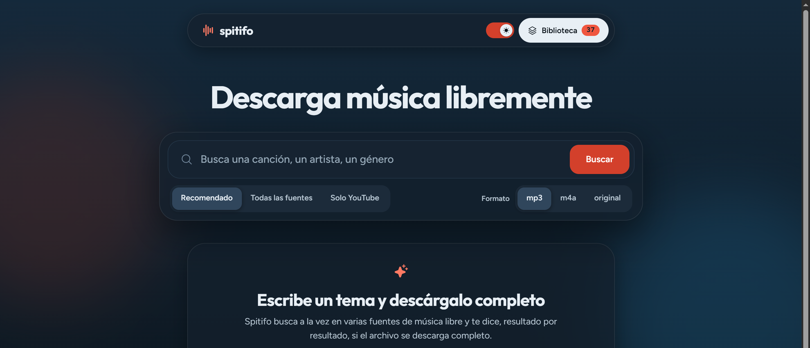
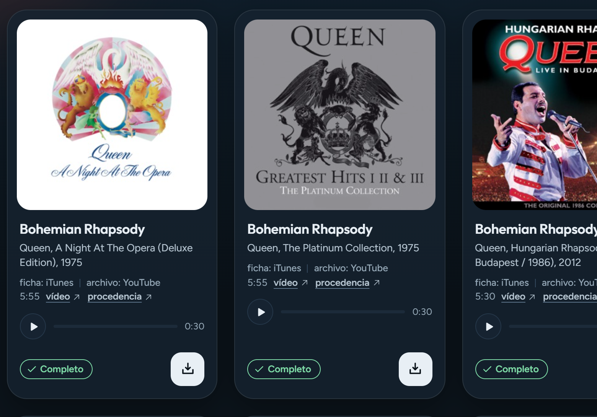

<div align="center">

# 🎵 Spitifo

**Search a song, download it in full — with the tags already written**

Free-licence catalogues + YouTube as a last resort · Identity verification on every file




*Local-first. No accounts, no cloud, no tracking.*

</div>

---

## Table of contents

- [Overview](#overview)
- [The hard part: knowing what you downloaded](#the-hard-part-knowing-what-you-downloaded)
- [How the sources work](#how-the-sources-work)
- [The matcher](#the-matcher)
- [Results in the browser](#results-in-the-browser)
- [Getting started](#getting-started)
- [Configuration](#configuration)
- [API](#api)
- [Project structure](#project-structure)
- [Tests](#tests)
- [Legal](#legal)

## Overview

Most "download this song" tools hand you a file and stop. Spitifo goes one step
further: after every download it **opens the file and checks that it is actually the
song you asked for**, and if it isn't, it says so in plain language.

That single feature is what the rest of the project is built around. It exists because
the obvious implementations are quietly wrong:

- Internet Archive stores **one item per track**, but titles the item after the
  *concert*. Search "Bohemian Rhapsody" and you get a Phish show because that song is
  number 21 on the setlist.
- The audio filenames are meaningless: `ph2022-12-31_s3t04.mp3` never says which song
  it holds.
- YouTube is full of rips, covers and hour-long compilations, all titled "Bohemian
  Rhapsody".

So a naive downloader will confidently save you 45 seconds of the wrong track and call
it a day.

| Feature | What it does |
| --- | --- |
| **Identity verification** | Reads the real ID3 tags of the downloaded bytes and scores them against your query. Reports `match`, `partial`, `mismatch` or `unknown`. |
| **Honest file naming** | A mismatch is saved under the title actually in the file, never under the title you searched for. |
| **Multi-source search** | Internet Archive, Wikimedia Commons, iTunes and Jamendo queried in parallel, then merged and de-duplicated. |
| **Matched mode** | iTunes supplies clean metadata; yt-dlp supplies the full-length audio. Best of both. |
| **Concurrent downloads** | Every download is tracked independently: its own progress toast, its own spinner, its own auto-dismiss. |
| **Light and dark themes** | Follows your system preference, remembers your choice, no flash on load. |
| **Built-in player** | Custom scrubber, volume and keyboard controls. Native `<audio>` chrome is hidden on purpose. |
| **Show grouping** | Archive concerts expand into their real setlist, each track downloadable on its own. |

## The hard part: knowing what you downloaded

After the audio lands on disk, `identify.py` reads the **first 256 KB** with mutagen and
compares the parsed tags against your query. The comparison is a word-overlap score with
stopwords removed (`live`, `remix`, `feat.`, `version`, `remaster…`).

| Verdict | Meaning | What you see |
| --- | --- | --- |
| `match` | ≥ 0.8 overlap — this is the track you asked for | nothing, it's fine |
| `partial` | ≥ 0.4 — related, but not certainly the same recording | nothing |
| `mismatch` | **this is not what you searched for** | a warning naming the real title |
| `unknown` | the file carries no tags to check | a warning: *could not verify* |

Two deliberate decisions here:

**`unknown` warns too.** "I could not verify this" is more honest than a green tick that
nobody ever issued.

**The filename comes from the file.** If a download does not match, it is written to disk
under the title its tags actually contain. The file on your disk never lies about its
own contents.

> [!NOTE]
> The verdict is computed **after** the download, against the real title of the file that
> landed — not against the metadata you searched with. Publishing it through the job
> payload is what lets the UI show it without a second round trip.

## How the sources work

| Source | Status | What you actually get |
| --- | --- | --- |
| **Internet Archive** | Works, no key | Full downloads. Live concerts, 78rpm transfers, community uploads |
| **Wikimedia Commons** | Works, no key | Full downloads. CC and public-domain audio |
| **iTunes Search** | Works, no key | Huge, clean catalogue — but **30-second previews only** |
| **Jamendo** | Needs `JAMENDO_CLIENT_ID` | Full MP3s from independent artists (free key) |
| **yt-dlp** | Off by default | Full-length audio from YouTube — see [Legal](#legal) |

The asymmetry in that table *is* the design problem. iTunes has the best metadata and
the worst audio; YouTube has the audio and the worst metadata. Matched mode exists to
join them.

### Two traps worth knowing about

**Archive is not just music.** It is audio in general. Searching `Numb Linkin Park`
returns *"HUBS report"*, *"Chaos in Portland"* and *"Toe sucking burglar strikes in
Florida"*. Two filters in `sources.py` prevent that:

- `looks_like_music()` drops titles carrying podcast / news / sermon / audiobook words.
- `relevance()` scores 0–1 and requires the item to contain **most of the distinctive
  words** of your query. An item matching only "park" scores 0.13; the correct one, 0.67.

Together they turn a search whose first three hits were podcasts into one where every
result is music. **Apply both to any new source.**

**Archive needs AND between words.** `advancedsearch` requires every term, so
`"linkin park numb"` returns zero even though *Meteora* is uploaded. The adapter tries
progressively looser variants and falls back to an OR over the longest words, then
re-ranks by real relevance. And `httpx` needs `params` as a **list of tuples** — repeating
keys in a dict silently returns documents with every field empty.

## The matcher

Matched mode pairs each iTunes track with the right YouTube video. This is not a
similarity search: *Bohemian Rhapsody* exists by Queen, by Panic! At the Disco and by
Pentatonix, and "closest title wins" sent all three to Queen's video.

| Signal | Weight | Why |
| --- | --- | --- |
| Channel name contains the artist | +0.3 | Strongest and cheapest signal available |
| Title matches **and** duration within 12 s | +0.2 | Separates covers and live versions |
| Duration off by more than 90 s | Reject | Live vs studio, remix vs original |
| No channel **and** no (title + duration) | **No match** | Better to say "none" than to download the wrong song |

A video is never reused for two different tracks.

<div align="center">

| Query | Behaviour |
| --- | --- |
| `bohemian rhapsody` | Queen → Queen official, Panic! → a different video, Pentatonix → a different video |
| `pink floyd` | Reports "no full version" for 5 of 6 instead of inventing one |

</div>

## Results in the browser



Each card states where **every** piece of data came from:

> `ficha: iTunes` · `archivo: YouTube` · `3:07` · vídeo · procedencia

The labels are not decoration. In matched mode iTunes only *contributes metadata* while
yt-dlp *downloads the audio*, so an unlabelled "iTunes · 3:07" reads as if the complete
track came from iTunes — which would be false, since iTunes only serves 30-second
previews.

**Verified accessibility:** every text/background pair was measured, not eyeballed.
The lowest ratio in either theme is **6.04:1** (dark) and **7.43:1** (light), all above
the WCAG AA threshold of 4.5:1. The layout is verified down to 390 px wide with no
horizontal overflow and 44 px minimum touch targets.

## Getting started

**Requirements:** Python ≥ 3.11, Node.js ≥ 18, and **ffmpeg** on your `PATH` for format
conversion. Without ffmpeg everything still works, but choosing mp3 or m4a for a file
published in another format (`.flac`, `.ogg`, `.opus`, `.wav`) stores it unconverted.
The `original` format never converts: free-licence files are kept exactly as published,
while YouTube downloads always end up as mp3.

```bash
git clone https://github.com/asormar/spitifo.git
cd spitifo

python -m venv .venv
.venv/Scripts/pip install -r requirements.txt      # Windows
# .venv/bin/pip install -r requirements.txt        # macOS / Linux

cd frontend && npm install && npm run build && cd ..
```

The API serves the built frontend, so everything runs on one port:

```bash
.venv/Scripts/python.exe -m uvicorn backend.app.main:app --port 8000
```

Open **http://127.0.0.1:8000**.

<details>
<summary><b>Frontend development</b></summary>

```bash
cd frontend
npm run dev      # http://localhost:5173, proxies /api to :8000
```

Vite reloads on save. Run the backend separately as shown above.

</details>

<details>
<summary><b>Enabling the YouTube source</b></summary>

```bash
# PowerShell
$env:YTDLP_ENABLED=1
.venv\Scripts\python.exe -m uvicorn backend.app.main:app --port 8000
```

`run.bat` in the repo root already sets this for you on Windows.

Read the [Legal](#legal) section before you do.

</details>

## Configuration

| Variable | Default | Purpose |
| --- | --- | --- |
| `SPITIFO_LIBRARY` | `./library` | Where downloads are written |
| `JAMENDO_CLIENT_ID` | — | Enables the Jamendo source (free key) |
| `YTDLP_ENABLED` | `0` | Enables the yt-dlp source |

Downloads land in `library/<artist>/<artist> - <title>.mp3` with ID3 tags written by
mutagen: canonical title, artist, album and year taken from the metadata source, not
from the YouTube video title.

## API

| Method | Route | Description |
| --- | --- | --- |
| `GET` | `/api/health` | Which sources are active right now |
| `GET` | `/api/search` | Search every active source (`mode`, `source`, `limit`) |
| `POST` | `/api/resolve` | Turn a catalogue entry into a playable URL |
| `GET` | `/api/verify` | Inspect what is inside an item without downloading it |
| `GET` | `/api/setlist` | Expand an Archive concert into its real setlist |
| `POST` | `/api/download` | Start a download; returns a `job_id` |
| `GET` | `/api/download/progress/{job_id}` | Progress, speed, ETA and identity verdict |
| `GET` | `/api/library` | Everything already downloaded, with durations |
| `GET` | `/api/audio?path=` | Stream a file from the library |

Interactive docs are served at `/docs` while the API is running.

<details>
<summary><b>Search modes</b></summary>

| Request | Result |
| --- | --- |
| `mode=matched` (default) | iTunes metadata + yt-dlp audio |
| `mode=ytdlp` alone | Does **not** filter — returns every source |
| `mode=ytdlp&source=ytdlp` | YouTube only |
| `mode=matched&source=X` | **Degrades matched mode** and loses the pairing |

That last row is a real trap in the API: combining a source filter with matched mode
silently falls back to a plain search. The UI derives the source from the mode
automatically so you cannot hit it by clicking.

</details>

## Project structure

```
backend/app/
  main.py          FastAPI app, routes, background download tasks
  sources.py       Source adapters, anti-noise filters, relevance ranking
  ytdlp_source.py  YouTube via yt-dlp: formats, ffmpeg postprocess, progress, locks
  matcher.py       Pairs metadata entries with the right video
  identify.py      Reads real tags and scores them against your query
  downloader.py    Streaming, ffmpeg conversion, ID3 writing, library scan
  models.py        Track type and filename sanitisation
  config.py        Shared constants
frontend/src/
  main.jsx         The whole interface: search, cards, player, theme, downloads
  style.css        Design tokens, both themes, layout and motion
docs/              Screenshots used in this README
tests/             137 tests, offline by default
```

## Tests

```bash
.venv/Scripts/python.exe -m pytest -m "not integration" -q   # offline, ~2 s
.venv/Scripts/python.exe -m pytest -q                         # everything, needs network
```

**137 tests: 136 pass, 1 xfail.** The xfail is a deliberately strict marker on
`looks_like_music()`, which does not yet reject the Spanish word *curso*; the day
someone fixes it, the test fails and forces the marker to be removed.

One integration test is **intermittent**: `test_search_resolve_download_verifica_tags`
depends on an Internet Archive node that intermittently answers `403 Forbidden`, so a
given run reports it either as a failure or as a skip. It is external flakiness, not a
regression — the same suite passes fully when the node answers.

What is actually covered, beyond the usual:

- **The matcher runs fully offline** against a fake YouTube source, including the
  Bohemian Rhapsody regression where three same-titled tracks must resolve to three
  different videos.
- **Concurrent downloads of the same track** are tested by faking `yt_dlp` and making
  the second download fail with `OSError(32)` exactly as Windows would. The test asserts
  the two never touch the file at the same time — and it was verified to fail when the
  lock is removed.
- **Integration tests** hit the real APIs with explicit timeouts and skip with a stated
  reason when an external service fails. An assertion is never rewritten to make a test
  pass.

> [!IMPORTANT]
> `testpaths = tests` in `pytest.ini` is load-bearing. Without it pytest collects from
> the repository root and the whole suite fails during collection.

## Legal

> [!WARNING]
> **The yt-dlp source downloads from YouTube.** That violates YouTube's Terms of
> Service and is unlawful in most jurisdictions, including Argentina and the European
> Union. It ships here disabled (`YTDLP_ENABLED=0`).

Everything else in Spitifo is built on sources that are meant to be used this way:
Internet Archive, Wikimedia Commons, iTunes previews and Jamendo. Those work without
the flag.

The tool is published for personal study and experimentation. If you intend to
redistribute it, host it as a service, or use it commercially, **check what applies in
your jurisdiction first** — that is your call to make, not this repository's.

## License

MIT.

The music itself is not part of this repository. What you download is subject to the
licence of whichever source it came from; the provenance link on every result tells you
which one that was.
